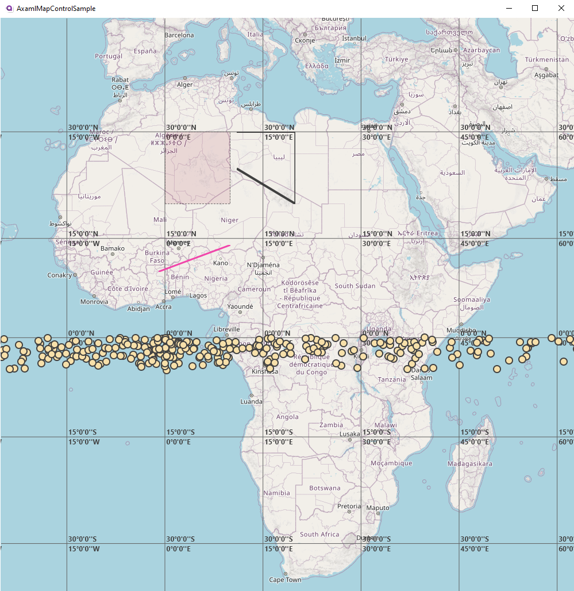

# AxamlMapControl

An interactive map for your app — explore places, display location data, and make geography part of your story.

Pan and zoom around a map, place your own data on it, and add lines, areas, and other visual layers.

<p align="center">
  
</p>

The image is an existing project screenshot, not a verification of the current build.

## Current development version

This README describes the `fix/axamlmapcontrol-stability` branch. Its changes have not been merged into `master` by this work.

The projects now target .NET 10. The UI dependencies remain on Avalonia 0.10.22; migration to a modern Avalonia major version is not complete. Build and test results from before the dependency update do not validate the updated projects. Check the latest matching commit in [GitHub Actions](https://github.com/beskot/Map/actions).

## What you can build

- A pannable, zoomable map using raster tiles from a configurable source.
- Location-based overlays with lines, polylines, polygons, and paths.
- Data-bound map items with custom appearance and selection.
- A latitude/longitude grid using `MapGraticule`.

The repository includes a sample application, an HTTP tile loader, an in-memory cache, and an experimental SQLite cache. It does not include a tile service.

## Run the sample

You need a stable .NET 10 SDK, a graphical desktop session, and network access to restore packages and fetch uncached tiles. The SDK selection policy is in [global.json](global.json). The current CI builds and tests on Windows; that is not a cross-platform UI validation.

```sh
git clone --branch fix/axamlmapcontrol-stability https://github.com/beskot/Map.git
cd Map
dotnet --info
dotnet restore Map.sln
dotnet build Map.sln --configuration Release --no-restore
dotnet test AxamlMapControlTests/AxamlMapControlTests.csproj --configuration Release --no-build --no-restore
dotnet run --project AxamlMapControlSample/AxamlMapControlSample.csproj --configuration Release --no-build
```

The sample currently uses a Switzerland tile endpoint. Availability, geographic coverage, and permitted usage depend on that provider. Replace its source and choose a suitable map center for your use case.

## Add a map to your application

These examples use the current Avalonia 0.10 API. Do not copy the theme configuration unchanged into an application using a different Avalonia major version.

### 1. Reference the library

For a source checkout, add a project reference from your application, adjusting both paths:

```sh
dotnet add path/to/YourApp.csproj reference path/to/Map/AxamlMapControl/AxamlMapControl.csproj
```

Use a .NET 10 application and compatible Avalonia package versions. This guide uses a source reference; it does not assume that a NuGet release is available.

### 2. Include the styles

Add the map style include to your existing `App.axaml` styles. The sample uses:

```xml
<Application.Styles>
    <FluentTheme Mode="Light"/>
    <StyleInclude Source="avares://AxamlMapControl/Themes/Default.axaml"/>
</Application.Styles>
```

Keep your existing application class and data templates. See [the sample App.axaml](AxamlMapControlSample/App.axaml) for the complete file.

### 3. Configure the tile source

Place this content inside your window or view. Replace the example tile URL with a service you are authorized to use; `tiles.example` is a placeholder, not a working service.

```xml
<Grid xmlns="https://github.com/avaloniaui"
      xmlns:map="using:AxamlMapControl.Source">
    <map:Map Background="#FFFEFEFE"
             MinZoomLevel="0"
             MaxZoomLevel="15"
             ZoomLevel="4"
             Center="46.8, 8.2">
        <map:Map.TileLayer>
            <map:MapTileLayer>
                <map:MapTileLayer.TileSource>
                    <map:TileSource UriStringFormat="https://tiles.example/{z}/{x}/{y}.png"/>
                </map:MapTileLayer.TileSource>
            </map:MapTileLayer>
        </map:Map.TileLayer>
        <map:MapGraticule/>
    </map:Map>
</Grid>
```

`Center` uses latitude, longitude. The source substitutes `{z}`, `{x}`, and `{y}` with the tile zoom and coordinates. The current layer assumes 256-pixel tiles. Match the zoom limits to your provider.

Drag with the left mouse button to pan; use the mouse wheel to zoom around the pointer.

### 4. Add your own geometry

Declare `xmlns:shape="using:AxamlMapControl.Source.Shapes"` on your view, alongside the `map` namespace. Add a location layer inside `map:Map`:

```xml
<map:MapLocationLayer>
    <shape:MapLine StartPoint="46.8, 8.2"
                   EndPoint="47.0, 8.5"
                   Stroke="#E4707A"
                   StrokeThickness="3"/>
    <shape:MapPolygon Locations="46.7,8.0 46.7,8.3 46.9,8.3 46.9,8.0"
                      Stroke="#404040"
                      StrokeThickness="1"
                      Fill="#20A93144"/>
</map:MapLocationLayer>
```

For data-bound markers, selection styles, polylines, and paths, see [MainWindow.axaml](AxamlMapControlSample/Views/MainWindow.axaml).

## Tile loading and caching

The HTTP loader allows up to four concurrent requests per loader instance, including overlapping batches. A batch has its own queue and source reference. Its default HTTP client has a 15-second timeout.

`TileImageLoader` has an overload accepting a `CancellationToken`. The existing `ITileImageLoader` interface and map layer do not yet propagate cancellation automatically when the view changes.

The default memory cache:

- Uses the tile URI as its key.
- Limits cached encoded image data to 64 MiB per cache instance by default.
- Expires entries 10 minutes after insertion.
- Does not store failed, empty, or individually oversized responses.

This limit is not a cap on total application memory: visible tiles, decoded images, and other objects use additional memory. A custom size limit can be passed to the `TileImageCache` constructor.

The SQLite implementation is experimental, not a ready-made offline map solution. Its lookup does not distinguish tile providers, saves are not awaited correctly, and changing the data source needs lifecycle fixes. Do not share a cache database between providers or rely on this implementation for durable storage without addressing these issues.

Choose a tile provider appropriate for your application and follow its attribution, request, and caching requirements. Provider attribution is not added automatically by the map example.

## Build, tests, and CI

The tests cover basic projection conversion, loader concurrency and cancellation, batch isolation, and memory-cache behavior. They do not establish full UI, SQLite, or cross-platform correctness.

To collect test results and coverage locally after building:

```sh
dotnet test AxamlMapControlTests/AxamlMapControlTests.csproj --configuration Release --no-build --no-restore --logger "trx;LogFileName=tests.trx" --collect:"XPlat Code Coverage" --results-directory TestResults
```

The [workflow](.github/workflows/verify-stability.yml) runs on pushes to `fix/axamlmapcontrol-stability`. It installs .NET 10, restores dependencies, builds the solution, runs tests with coverage, and uploads available results. A workflow definition is not a claim that the latest run passed.

## Project layout

| Directory | Contents |
| --- | --- |
| `AxamlMapControl/Source` | Map controls, transforms, tile loading, projections, and overlays |
| `AxamlMapControl/Source/Cache` | Memory and SQLite cache implementations |
| `AxamlMapControl/Themes` | Control styles |
| `AxamlMapControlSample` | Desktop example with shapes and selectable items |
| `AxamlMapControlTests` | Automated tests |
| `.github/workflows` | Build and test automation |

## Known limitations and next work

- Tile-source changes do not yet invalidate and reload the visible layer correctly.
- The tile layer still needs property-registration and asynchronous lifecycle fixes, including protection against stale results.
- Images are still decoded inside `Render`; decoded-image reuse and explicit resource ownership need improvement.
- Automatic cancellation from the map layer and cache wrappers is not implemented.
- SQLite cache correctness and lifecycle fixes remain outstanding.
- Migration beyond Avalonia 0.10 and broader UI/platform tests remain outstanding.

## Contributing

For a bug report, include the branch or commit, operating system, SDK version, reproduction steps, and relevant build or test output. Do not include private tile-service keys or credentials. Keep behavior fixes and major dependency migrations in separate changes when practical.

## License

AxamlMapControl is licensed under the [MIT License](LICENSE). Map tiles and other provider content have their own terms and are not covered by this project's license.
